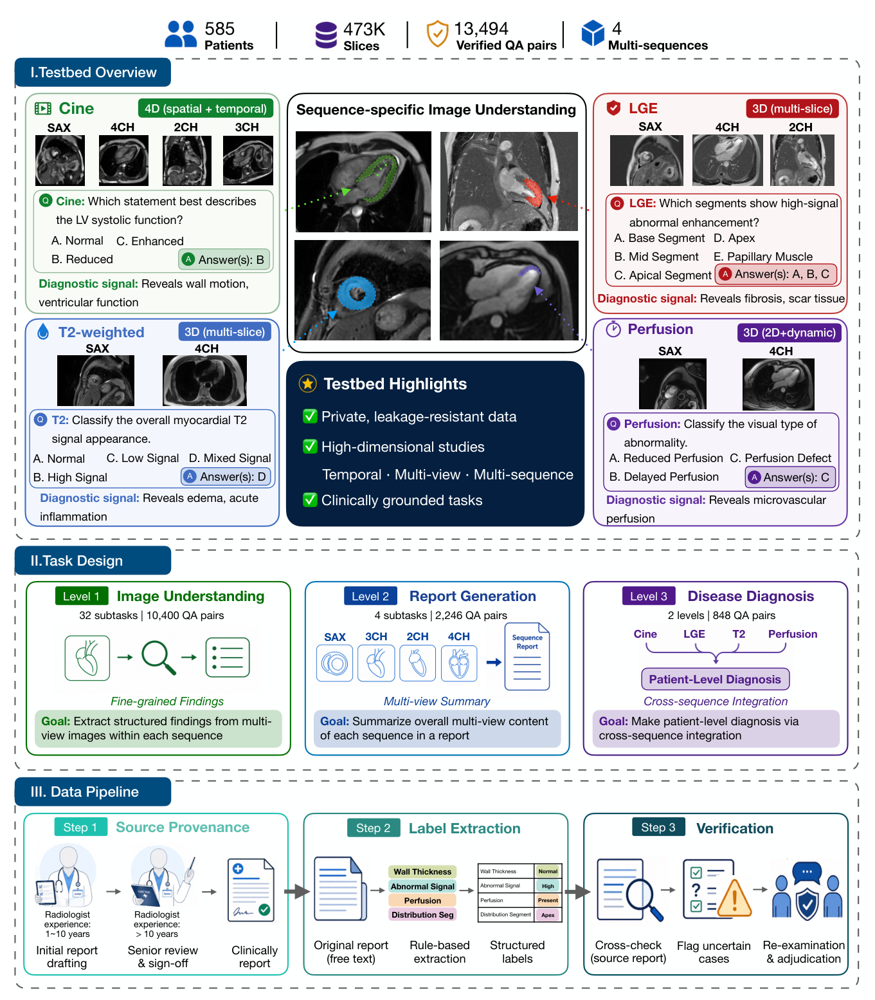
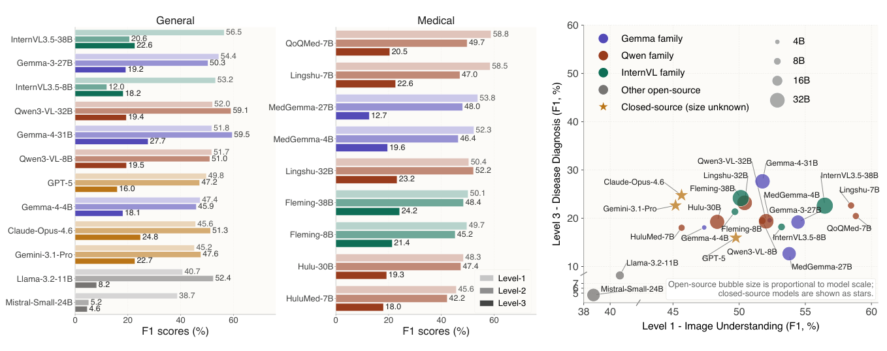
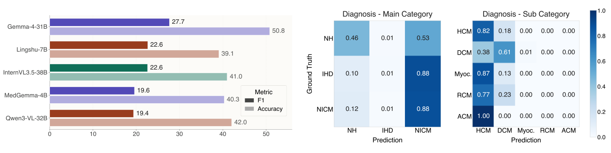

<h1 align="center">🫀 CardioLens</h1>

<h3 align="center">Revealing the Clinical Reality Gap of MLLMs via Multi-Sequence Cardiac MRI Evaluations</h3>

<p align="center"><strong>A clinically grounded benchmark for evaluating multimodal large language models on real-world cardiac MRI interpretation.</strong></p>

<p align="center">
  <a href="https://neurips.cc/Conferences/2026/CallForEvaluationsDatasets"></a>
  <a href="https://arxiv.org/abs/2606.00123"></a>
  <a href="https://huggingface.co/datasets/kiwi12138/CardioLens"></a>
  <a href="https://github.com/kiwi12138/CardioLens"></a>
</p>

<p align="center">
  <a href="https://arxiv.org/abs/2606.00123">📄 Paper</a> &nbsp;·&nbsp;
  <a href="https://huggingface.co/datasets/kiwi12138/CardioLens">🤗 Dataset &amp; Access</a> &nbsp;·&nbsp;
  <a href="#code-and-reproducibility">💻 Code</a> &nbsp;·&nbsp;
  <a href="#citation">📚 Citation</a>
</p>

---

## Overview

**Can strong performance on medical vision–language benchmarks translate into reliable interpretation of a real clinical imaging study?**

Existing medical multimodal large language model (MLLM) benchmarks often use publicly available, isolated images and short recognition-style questions. Real cardiovascular magnetic resonance (CMR) interpretation is different: a physician must combine evidence from **multiple sequences, anatomical views, and temporal phases** to identify findings, formulate a report, and reach a patient-level diagnosis.

**CardioLens** is a leakage-resistant, clinically grounded evaluation testbed built from non-public hospital CMR studies and expert-verified, report-derived annotations. It evaluates MLLMs at **three increasingly demanding levels** of clinical interpretation: **image understanding, report generation, and disease diagnosis**. The accompanying paper benchmarks **24 MLLMs** and examines where their apparent medical understanding fails under more realistic evaluation conditions.

> **Main takeaway:** High scores on conventional medical VQA benchmarks do not establish reliable clinical interpretation. On CardioLens, model performance drops as tasks demand more complete synthesis of cardiac MRI evidence.

### At a glance

| | Full benchmark described in the paper | Released dataset subset |
|:--|--:|--:|
| **Patients** | **585** | **100** |
| **CMR slices** | **473,896** | **78,707** |
| **Verified QA pairs** | **13,494** | **2,297** |
| **Imaging sequences** | Cine · LGE · Perfusion · T2 | Same four sequences |
| **Access** | Institutionally restricted research cohort | [Hugging Face — gated access](https://huggingface.co/datasets/kiwi12138/CardioLens) |

> **Full benchmark vs. released dataset:** The complete 585-patient cohort is used for the research benchmark described in the paper. The Hugging Face release contains **100 patients, 78,707 image slices, and 2,297 verified QA pairs**, with access provided through the dataset's gated-access conditions. The full cohort is **not** available for download.

## Why CardioLens?

CardioLens is designed to address three gaps between widely used medical VQA evaluations and real clinical workflows:

| Evaluation gap | CardioLens approach |
|:--|:--|
| **Potential benchmark contamination** from widely reused public datasets | Uses previously non-public hospital CMR studies to reduce exposure to pretraining data. |
| **Simplified visual inputs** such as a single 2D image | Evaluates evidence drawn from multi-view, multi-sequence, spatial and temporal CMR studies. |
| **Recognition-centric questions** that do not test clinical synthesis | Organizes evaluation around findings, structured reporting, and patient-level diagnosis. |

### Four complementary CMR sequences

| Sequence | Clinical evidence assessed |
|:--|:--|
| **Cine MRI** | Cardiac morphology, ventricular function, wall motion, and dynamic behavior |
| **Late Gadolinium Enhancement (LGE)** | Myocardial fibrosis/scar and enhancement patterns |
| **Perfusion MRI** | Myocardial perfusion abnormalities and their distribution |
| **T2-weighted MRI** | Myocardial edema, inflammation-related signal abnormalities, and localization |

## Benchmark Tasks

CardioLens evaluates three levels of **increasing clinical complexity**, from recognizing sequence-specific findings to generating reports and making patient-level diagnoses. **Each tier is evaluated independently**: Level 2 does not require predictions from Level 1, and Level 3 predicts directly from multi-sequence images rather than consuming the model's generated reports.

<p align="center">
  
</p>
<p align="center"><sub><b>Figure 2.</b> CardioLens benchmark design, multi-sequence inputs, and data construction pipeline (from the paper).</sub></p>

| Tier | Task | What is evaluated | Full benchmark size |
|:--|:--|:--|--:|
| **Level 1** | **Image Understanding** | Sequence-specific clinical findings, including morphology, function, enhancement, perfusion, and edema; single- and multi-label questions | **32 subtasks · 10,400 QA** |
| **Level 2** | **Report Generation** | Clinically coherent, structured descriptions integrating evidence across views **within each sequence** | **4 subtasks · 2,246 QA** |
| **Level 3** | **Disease Diagnosis** | Patient-level etiological classification and non-ischemic cardiomyopathy subtyping from **multiple sequences** | **2 subtasks · 848 QA** |

For disease diagnosis, CardioLens evaluates **Normal Heart (NH)** vs. **Ischemic Heart Disease (IHD)** vs. **Non-Ischemic Cardiomyopathy (NICM)**, followed by NICM subtyping into **HCM, DCM, RCM, ACM, and Myocarditis**.

The annotations are derived from clinical reports that underwent senior radiologist review; report-derived labels are then extracted and verified, while diagnosis targets are grounded in patient discharge records. See the [paper](https://arxiv.org/abs/2606.00123) for complete task definitions and verification details.

## Key Findings

Across **24 state-of-the-art general-purpose and medical MLLMs**, the paper reports four important observations:

1. **A pronounced clinical reality gap.** Performance deteriorates as evaluation moves from recognizing individual CMR findings to reporting and patient-level diagnosis. Strong conventional medical VQA results do not transfer reliably to this setting.
2. **Category collapse at diagnosis.** Models frequently favor common abnormal categories instead of distinguishing clinically different conditions, revealing a failure of evidence-grounded prediction.
3. **More or better-selected slices are not enough.** Random, clinically motivated, and data-driven slice-selection strategies, evaluated across different input budgets, produce only modest changes—typically around **1 percentage point** in the analyses reported in the paper.
4. **Explicit reasoning prompts do not reliably repair visual grounding.** Requests for clinical justifications do not consistently improve performance and can reduce recall by encouraging more conservative predictions.

<p align="center">
  
</p>
<p align="center"><sub><b>Figure 3.</b> Performance across the three evaluation levels. Stronger image-understanding performance does not reliably translate into stronger patient-level diagnosis.</sub></p>

<p align="center">
  
</p>
<p align="center"><sub><b>Figure 4.</b> Diagnosis-stage failure analysis: seemingly moderate accuracy can obscure collapse toward frequent disease categories.</sub></p>

**Implication:** Progress toward clinically useful MLLMs requires more than better performance on isolated medical images. It requires reliable use of distributed visual evidence and clinically meaningful synthesis across a complete study.

## Dataset and Access

**Dataset repository:** **[🤗 kiwi12138/CardioLens on Hugging Face](https://huggingface.co/datasets/kiwi12138/CardioLens)**

The released data are hosted separately from this code repository. The Hugging Face repository is **gated**: visit the dataset page, sign in, and follow its access conditions to obtain access to the files. **Do not assume that the full 585-patient study cohort is part of the release.**

### Files in the release

| File on Hugging Face | Contents |
|:--|:--|
| [`CardioLens_NIfTI.zip`](https://huggingface.co/datasets/kiwi12138/CardioLens/tree/main) | De-identified CMR imaging studies in NIfTI format |
| [`CardioLens_VQA.zip`](https://huggingface.co/datasets/kiwi12138/CardioLens/tree/main) | Benchmark VQA data and related evaluation assets |
| [`Diagnosis_Label.xlsx`](https://huggingface.co/datasets/kiwi12138/CardioLens/tree/main) | Patient-level diagnostic labels |
| [`Reports.xlsx`](https://huggingface.co/datasets/kiwi12138/CardioLens/tree/main) | Report references associated with the released studies |

**Released subset statistics.** The current Hugging Face release contains **100 patients, 78,707 CMR slices, and 2,297 verified QA pairs**, broken down into **1,805 image-understanding**, **361 report-generation**, and **131 disease-diagnosis** evaluation items. These counts match the 100-patient subset documented in Appendix H of the paper.

**Important for evaluation:** The inference code below consumes JSON samples containing image paths (e.g., selected 2D frames). The NIfTI volumes and the evaluation-ready image paths are different representations; ensure the referenced slices/images are prepared and the paths in your JSON resolve correctly before running the evaluator.

### Access and intended use

- The released imaging studies are **de-identified** and provided for **research and benchmark evaluation**, not for clinical decision-making.
- Access to the 100-patient release is managed through [Hugging Face gated access](https://huggingface.co/datasets/kiwi12138/CardioLens). Please follow the conditions displayed on the dataset page.
- The Hugging Face repository currently lists **CC BY-NC-SA 4.0** as its license. Check the dataset page for applicable access and reuse terms.

## Code and Reproducibility

This repository provides the evaluation implementation accompanying CardioLens:

- **MLLM evaluation** (`cardiolens_eval.py` and `run_models.py`): submit patient-level JSON samples and selected image inputs to supported model profiles through vLLM, then write predictions to CSV.
- **Task-Aware Multiple Instance Learning (MIL)** (`mil_code/`): train a data-driven slice selector and extract task-relevant top-*K* slices, used as one of the protocols analyzed in the paper.

The following technical sections retain the repository's original usage instructions and command-line examples.

### Repository Layout

```text
CardioLens/
├── cardiolens_eval.py              # Core inference and evaluation logic
├── run_models.py                   # Unified launcher for all model profiles
├── examples/
│   └── redacted_lge_sample.json    # Redacted example of the expected data format
├── assets/
│   └── figures/                   # Paper figures used in this README
│       ├── fig2_benchmark_overview.png
│       ├── fig3_model_performance.png
│       └── fig4_diagnosis_failure.png
├── requirement-env1.txt            # Dependencies for env1 (most models)
├── requirement-env2.txt            # Dependencies for env2 (Gemma4 only)
├── mil_code/                       # Task-Aware MIL for data-driven slice selection
│   ├── train.py                    # Train the MIL model
│   ├── evaluate.py                 # Evaluate a trained MIL checkpoint
│   ├── extract_topk.py             # Extract top-K slices for MLLM evaluation
│   ├── README.md                   # MIL-specific documentation
│   └── src/
│       ├── __init__.py
│       ├── model.py                # Encoder + per-task transformer attention + classifier
│       ├── dataset.py              # Multi-sequence cardiac MRI dataset
│       ├── losses.py               # Multi-task loss + target-K sparsity regularization
│       ├── metrics.py              # Acc / Precision / Recall / F1 / EM
│       └── trainer.py              # Training loop
└── README.md                       # This file
```

### MLLM Evaluation Scripts

- [cardiolens_eval.py](cardiolens_eval.py): core inference and evaluation logic.
- [run_models.py](run_models.py): unified launcher supporting all model profiles (e.g. `hulu_med7b`, `qwen_8b`, `lingshu_hulu`, `qwen32_medgemma27`).

### Task-Aware MIL (Data-Driven Slice Selection)

The `mil_code/` directory contains the implementation of the Task-Aware Multiple Instance Learning (MIL) framework described in the paper. This model learns per-slice, per-task importance weights from sequence-level supervision, and its top-K outputs serve as inputs for the data-driven MIL sampling protocol used in MLLM evaluation.

Key components:
- **`train.py`**: Train the MIL model with multi-task loss and sparsity regularization.
- **`evaluate.py`**: Evaluate a trained checkpoint, reporting per-task Accuracy, Precision, Recall, F1, and Exact-match.
- **`extract_topk.py`**: Extract top-K slice indices (both per-task and task-averaged) for downstream MLLM evaluation.

See [`mil_code/README.md`](mil_code/README.md) for detailed usage instructions and alignment with the paper.

### Other Files

- [examples/redacted_lge_sample.json](examples/redacted_lge_sample.json): redacted example of the expected data format.
- [requirement-env1.txt](requirement-env1.txt): dependencies for env1 (most models).
- [requirement-env2.txt](requirement-env2.txt): dependencies for env2 (Gemma4 only).

### Environment Setup

During evaluation, we found that different models depend on different versions of the `transformers` library. We use the most compatible versions possible, but Gemma4 — a newer model — requires a higher version of `transformers` that cannot coexist with the other models in the same environment. Therefore, two separate Conda environments are needed:
- **`env1`** (`vlmqwen`): supports all models **except** Gemma4. Uses `requirement-env1.txt`.
- **`env2`** (`vlmgemma4`): supports Gemma4-based models only. Uses `requirement-env2.txt`.

Install a PyTorch wheel that matches your CUDA version first, then install the requirements.

#### env1 — Most models

```bash
cd CardioLens
conda create -n env1 python=3.11 -y
conda activate env1
pip install --index-url https://download.pytorch.org/whl/cu118 \
  torch==2.2.0+cu118 torchvision==0.16.0+cu118 --extra-index-url https://pypi.org/simple
pip install -r requirement-env1.txt
```

#### env2 — Gemma4 only

```bash
conda create -n env2 python=3.11 -y
conda activate env2
pip install --index-url https://download.pytorch.org/whl/cu118 \
  torch==2.2.0+cu118 torchvision==0.16.0+cu118 --extra-index-url https://pypi.org/simple
pip install -r requirement-env2.txt
```

#### MIL training environment

```bash
conda create -n mil python=3.11 -y
conda activate mil
pip install torch torchvision tqdm numpy
```

> **Compute note:** Evaluation depends on vLLM and GPU inference. CPU mode may work for limited testing but is far too slow for practical evaluation.

### Data Format

The evaluation scripts read a JSON array, where each element is one sample. The code prefers `conversations` for the user prompt and reference answer, but can fall back to `question`, `query`, `text`, and `answer` when needed. `image` may be a single path or a list of paths; if the paths are relative, the script resolves them using `--image_root`.

Example:

```json
{
  "qid": "patient0067::enhancement_status::mcq_1",
  "field": "Enhancement Status",
  "image": [
    "Images/patient0067_LGE_sax_slice_00.png",
    "Images/patient0067_LGE_sax_slice_01.png",
    "Images/patient0067_LGE_sax_slice_02.png",
    "Images/patient0067_LGE_sax_slice_03.png",
    "Images/patient0067_LGE_sax_slice_04.png",
    "Images/patient0067_LGE_sax_slice_05.png",
    "Images/patient0067_LGE_sax_slice_06.png",
    "Images/patient0067_LGE_sax_slice_07.png"
  ],
  "patient_id": "patient0067",
  "question_type": "Single Choice",
  "is_multiple_choice": false,
  "conversations": [
    {
      "from": "user",
      "value": "You are a Vision-Language Model (VLM) for cardiac LGE MRI.\nTask: Using the provided image frames, decide whether abnormal delayed enhancement is present (single-choice).\n\nStrict rules:\n- Choose exactly ONE option: A or B.\n- No explanations, reasoning, descriptions, confidence, or extra characters.\n- Even if uncertain, choose the most likely answer.\n\nOptions:\nA. No Abnormal Delayed Enhancement\nB. Abnormal Delayed Enhancement"
    },
    {
      "from": "assistant",
      "value": "B. Abnormal Delayed Enhancement"
    }
  ]
}
```

Each JSON file is a sample list: each item binds a set of slices, a question, a reference answer, and metadata. The evaluation writes one CSV row per sample.

### Running the Code

#### MLLM Evaluation

`run_models.py` is the unified entrypoint for all model profiles. It uses the selected `--profile` to fill in default values such as `max_tokens`, `max_model_len`, `dtype`, and `limit_mm_images`.

```bash
# Single-model evaluation (env1)
conda activate env1
python run_models.py \
  --profile hulu_med7b \
  --json_path ./examples/redacted_lge_sample.json \
  --json_root ./examples \
  --output_root ./outputs \
  --model_path /path/to/local_model \
  --image_root ./examples/images \
  --log_dir ./logs \
  --batch_size 1

# Paired-model evaluation (env1)
python run_models.py \
  --profile lingshu_hulu \
  --json_path ./examples/redacted_lge_sample.json \
  --json_root ./examples \
  --output_root ./outputs \
  --model_path /path/to/local_model \
  --image_root ./examples/images \
  --log_dir ./logs

# Gemma4 evaluation (env2)
conda activate env2
python run_models.py \
  --profile gemma_4_31b \
  --json_path ./examples/redacted_lge_sample.json \
  --json_root ./examples \
  --output_root ./outputs \
  --model_path /path/to/local_model \
  --image_root ./examples/images \
  --log_dir ./logs
```

You can also pass `--output_csv_path` directly if you already know the exact output file. Keep these rules in mind:
- If `--json_path` points to a single file, use either `--output_csv_path` or `--json_root` + `--output_root`.
- If `--json_path` points to a directory, you must use `--output_root`, and `--output_csv_path` is not allowed.

#### Task-Aware MIL Training & Slice Extraction

The MIL model is used for the data-driven slice selection protocol described in the paper. It learns per-slice, per-task importance weights from sequence-level image-understanding labels.

```bash
# 1. Train the MIL model
python mil_code/train.py \
  --cache-dir /path/to/preprocessed_cache \
  --label-json /path/to/labels.json \
  --checkpoint-dir ./checkpoints

# 2. Evaluate the trained checkpoint
python mil_code/evaluate.py \
  --checkpoint ./checkpoints/best_model_acc.pth \
  --cache-dir /path/to/preprocessed_cache \
  --label-json /path/to/labels.json \
  --output ./val_metrics.json

# 3. Extract top-K slices for downstream MLLM evaluation
python mil_code/extract_topk.py \
  --checkpoint ./checkpoints/best_model_acc.pth \
  --cache-dir /path/to/preprocessed_cache \
  --label-json /path/to/labels.json \
  --output ./topk_indices.json \
  --target-k 8
```

The `extract_topk.py` output provides both per-task selections (for image understanding evaluation) and task-averaged selections (for report generation and disease diagnosis). See [`mil_code/README.md`](mil_code/README.md) for full details.

### Common Arguments

- `--profile`: model profile, taken from `PROFILE_CONFIG` in [cardiolens_eval.py](cardiolens_eval.py).
- `--json_path`: a single JSON file or a JSON directory.
- `--json_root`: root directory used to build output paths.
- `--output_csv_path`: direct output path for single-file mode.
- `--output_root`: required for directory mode; output mirrors the JSON directory structure.
- `--image_root`: root directory used to resolve relative image paths.
- `--gpus`: for example, `--gpus 0 1`.
- `--batch_size`: inference batch size.
- `--limit_mm_images`: maximum number of images per sample; extra images are truncated.
- `--image_input_mode`: `pil`, `path`, or `both`.
- `--skip_no_image` / `--skip_missing_images`: skip problematic samples instead of failing.
- `--overwrite`: allow overwriting existing outputs.

If `--image_input_mode both` is used, the script runs both input modes and writes `_pil.csv` and `_path.csv` outputs.

### Available Profiles

`run_models.py` supports **all** profiles defined in `PROFILE_CONFIG`:

**env1 models** (use `requirement-env1.txt`):
`deepseek_vl2`, `deepseek_vl2_small`, `gemma_3_27b`, `internvl`, `llama_11b`, `mistral_small`, `phi_4`, `fleming_38b`, `hulu_med7b`, `hulu_30b`, `lingshu_7b`, `qoqmed_7b`, `qwen_8b`, `qwen_32b_reasoning`, `medgemma_4b`, `lingshu_hulu`, `qwen32_medgemma27`

**env2 models** (use `requirement-env2.txt`):
`gemma_4_4b`, `gemma_4_31b`

### Minimal Sanity Check

To verify the pipeline end to end, run the example JSON through a small batch and confirm that the CSV and logs are generated. Make sure the referenced example images are present (or update `--image_root` accordingly), and supply a compatible local model checkpoint.

```bash
conda activate env1
python run_models.py \
  --profile hulu_med7b \
  --json_path ./examples/redacted_lge_sample.json \
  --json_root ./examples \
  --output_csv_path ./outputs/sample.csv \
  --model_path /path/to/local_model \
  --image_root ./examples/images \
  --log_dir ./logs \
  --batch_size 1 \
  --overwrite
```

If you have more JSON files, point `--json_path` at the directory. The script will recursively process all `.json` files and preserve the same relative structure under `--output_root`.

## Citation

If CardioLens is useful for your research, please cite the paper:

```bibtex
@misc{su2026cardiolens,
  title        = {CardioLens: Revealing the Clinical Reality Gap of MLLMs via Multi-Sequence Cardiac MRI Evaluations},
  author       = {Su, Zixian and Zhang, Hongkai and Gao, Fan and Su, Encheng and Qu, Taiping and Guo, Jingwei and Zhang, Nan and Wang, Hui and Zhou, Zhen and Bo, Kairui and Chen, Yan and Ren, Yue and Li, Shuai and Xu, Lei and Zhang, Henggui},
  year         = {2026},
  eprint       = {2606.00123},
  archivePrefix = {arXiv},
  primaryClass = {cs.CV},
  url          = {https://arxiv.org/abs/2606.00123}
}
```

## Acknowledgments

CardioLens is a collaborative research effort involving the **Beijing Academy of Artificial Intelligence (BAAI)**, **Beijing Anzhen Hospital / Capital Medical University**, **Beihang University**, and **King Abdullah University of Science and Technology (KAUST)**. We thank the clinical experts involved in data review, annotation verification, and study design.

---

<p align="center"><strong>CardioLens · From image recognition to clinically grounded CMR evaluation</strong></p>

<p align="center">
  <a href="https://arxiv.org/abs/2606.00123">Paper</a> ·
  <a href="https://huggingface.co/datasets/kiwi12138/CardioLens">Dataset</a> ·
  <a href="https://github.com/kiwi12138/CardioLens">Code</a>
</p>
